

  

  

  
  
  
  

 

  

  

  <a href="https://github.com/luomo66ccff/luomo-home"></a>
  <a href="https://github.com/luomo66ccff/luomocore"></a>
  
  <a href="https://github.com/luomo66ccff/luomofile-hub"></a>
  <a href="https://github.com/luomo66ccff/luomoterminal"></a>
  <a href="https://github.com/luomo66ccff/fog-harbor-archive"></a>

  
<b>更多手记 · More from the workshop</b>

   

  - [file-download-proxy](https://github.com/luomo66ccff/file-download-proxy) — whitelist-only FastAPI streaming download proxy with Range support and SSRF defenses.
  - [steam-automation-hub](https://github.com/luomo66ccff/steam-automation-hub) — read-only dashboard for ArchiSteamFarm telemetry and automation health.
  - [astrbot_plugin_bilibili_assistant](https://github.com/luomo66ccff/astrbot_plugin_bilibili_assistant) — AstrBot plugin for Bilibili comments, AI-assisted reply drafts and moderation.
  - [rogue-snake-server](https://github.com/luomo66ccff/rogue-snake-server) — a small standard-library backend for sessions, scores and leaderboards.
  - [hexo](https://github.com/luomo66ccff/hexo) — the blog behind [march7th.cn](https://www.march7th.cn): notes, experiments and longer stories.
  - [firefly](https://github.com/luomo66ccff/firefly) — an early character site for Firefly, kept as part of the journey.

 

  

  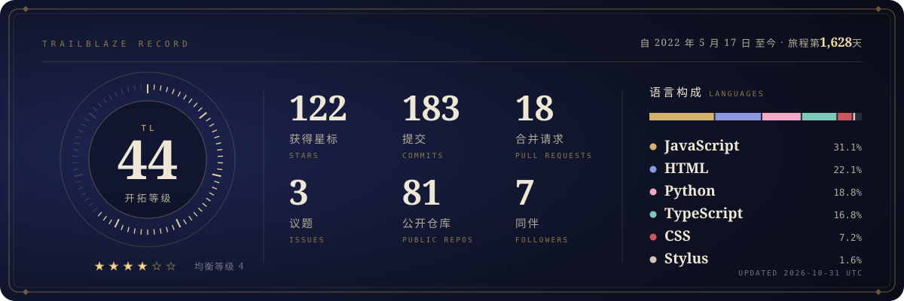

  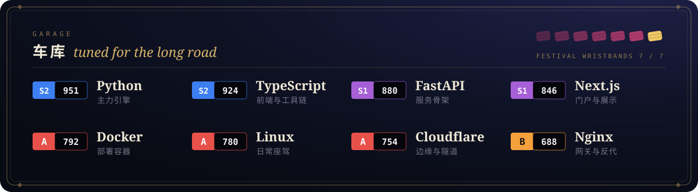

 

  

  

  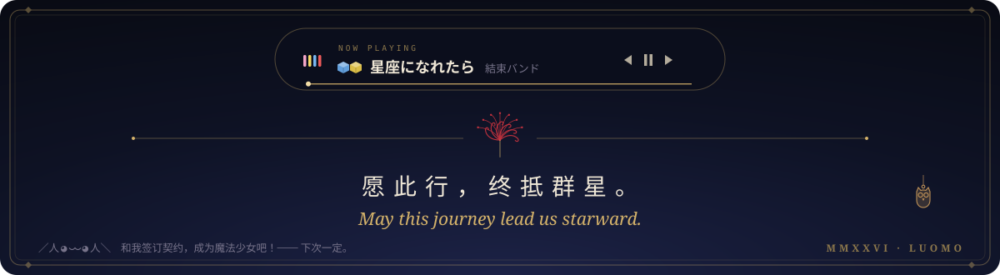

<!-- profile-readme: luomo66ccff · assets are built from design/ (static) and scripts/render-dynamic.mjs (daily) -->
